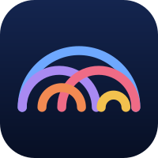
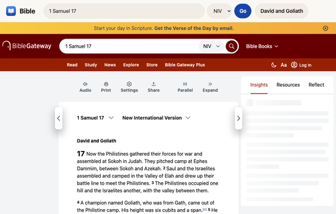
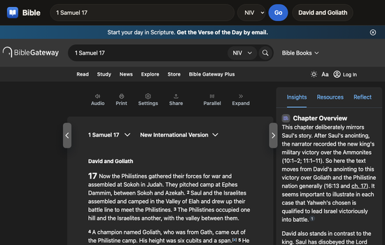

 

Read the Bible in the NIV or the King James. It opens on David and Goliath.

No account, no ads, no tracking. One page, a search box and a version picker. Type any passage, pick NIV or KJV, and the text comes from BibleGateway. One button takes you back to 1 Samuel 17.

<p>


</p>

Live at [bible.jaybulb.com](https://bible.jaybulb.com).

## Features

Any book, chapter or range: `Psalm 23`, `John 3:16`, `1 Samuel 17:45-47`. NIV and KJV. David and Goliath as the home page. Light and dark that follow your system.

There's a native app too: iPhone, iPad and Mac, with the King James built in so it works offline.

## Run it

```sh
open landing/index.html
cd app && xcodegen generate && open Bible.xcodeproj
./deploy.sh   # copies the brand files into landing/ and deploys the Worker
```

[Roadmap](docs/roadmap.md) · [Whitepaper](WHITEPAPER.md) · [Brand kit](brand/BRAND.md)

KJV text from [thiagobodruk/bible](https://github.com/thiagobodruk/bible) (MIT), public domain.
